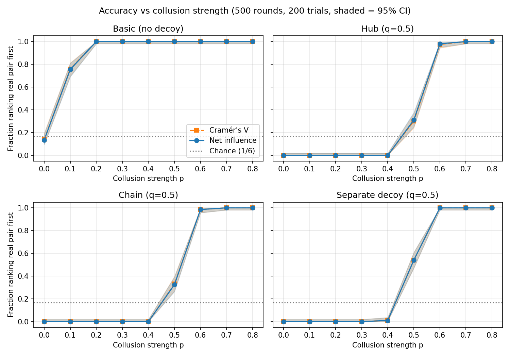
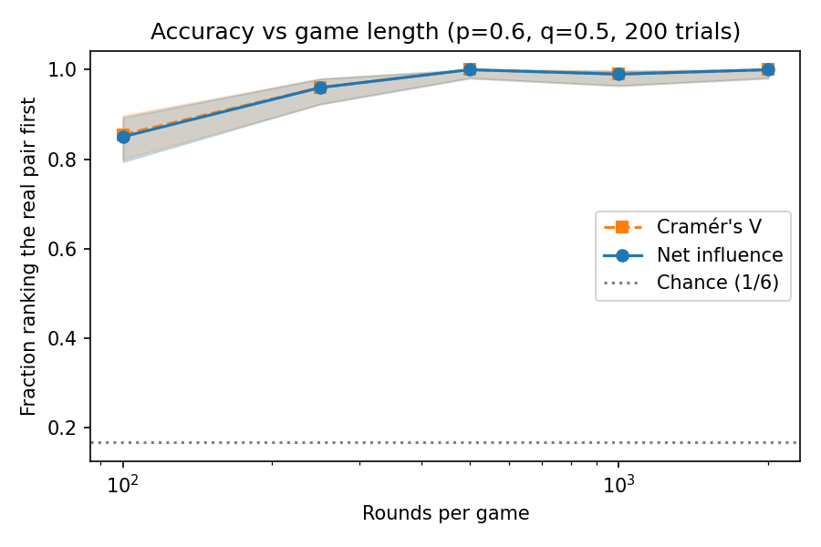
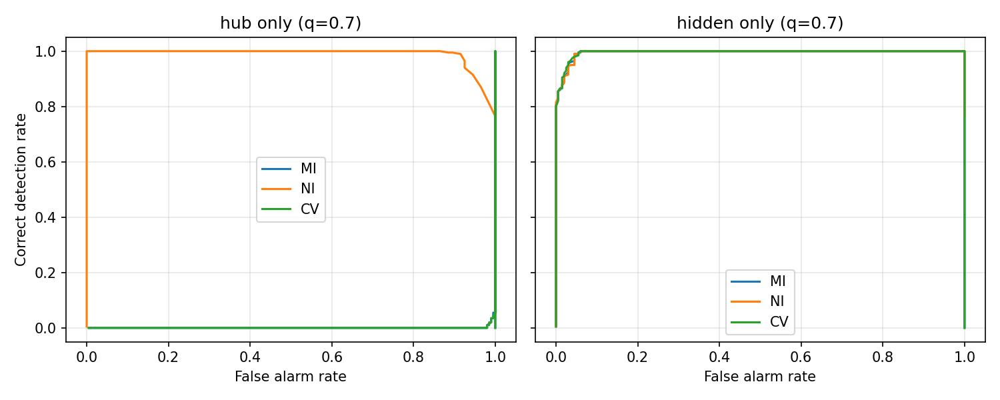

# Detecting Colluding Agents with Pairwise Net Influence

Project for the Apart Research AI Collusion Research Sprint (Question 1.4: information-theoretic detection of collusion in multi-agent games).

**Research question:** Can pairwise net influence (Bonjour et al., 2022) identify a colluding pair among four agents in repeated Rock-Paper-Scissors, and does it beat plain correlation (Cramér's V)?

**Answer in this toy setting:**
1. At **ranking** the planted pair first, net influence and Cramér's V performed identically. I found no evidence that net influence is better.
2. Net influence helped in one narrower case. When an innocent link is caused by another **logged** agent, it cut false alarms (100% to about 45% at the paper's 0.05 cutoff) and kept detecting real collusion at 5% false alarms, where raw mutual information and Cramér's V detected nothing.
3. It did **not** help when the cause of the innocent link is hidden (not logged).
4. When collusion depends on the previous round, flat scoring of any kind missed it, while conditioning on previous moves found it. Net influence and Cramér's V again tied.

## What I did

- Implemented pairwise net influence for the fully observable simultaneous case of Bonjour et al. (2022). Mutual information between two agents' moves gives γ(i;j). Then Γ(i;j) = γ(i;j) − max over k ≠ i, j of γ(k;j). Each pair is scored as min(Γ(i;j), Γ(j;i)).
- Added a Cramér's V baseline (the paper has no baseline) and raw mutual information (net influence without the subtraction).
- Simulated four-agent Rock-Paper-Scissors. In real-collusion games, agent 3 plays the move that beats agent 2's move with probability p, otherwise random. (2, 3) is the colluding pair.
- **Experiment 1 (ranking):** four scenarios (no decoy, hub, chain, separate decoy pair, decoy strength q = 0.5). A trial succeeds if the top-ranked pair is (2, 3). Chance is 1/6. 200 trials per setting, 95% Wilson intervals.
- **Experiment 2 (false alarms):** no-collusion games (null, hub only, hidden only) scored with the paper's rule that a pair is flagged if its score is at least α = 0.05, followed by detection rates at a fixed 5% false-alarm budget.

### Scenarios

| Scenario | Description |
|---|---|
| Basic | One real pair (2, 3), everyone else random |
| Hub | Agents 1 and 2 copy agent 0 with probability q, plus the real pair |
| Chain | Agent 1 copies agent 0, agent 2 copies agent 1, plus the real pair |
| Separate | Decoy pair (0, 1) with strength q, plus the real pair, sharing no agent |
| Null | No collusion, no links |
| Hub only | No collusion. Agents 1 and 2 both copy agent 0 (logged) with probability q |
| Hidden only | No collusion. Agents 0 and 1 copy a hidden, unlogged driver with probability q |

## Differences from the paper

- Four players instead of three, and a different hand-crafted collusion rule.
- Only the fully observable simultaneous case. No poker, no sequential games, no learned (DDQN) colluders.
- The ranking experiments pick the top pair instead of applying a threshold. The false-alarm experiments do use the α = 0.05 threshold.
- Cramér's V, raw MI and the hub/chain/separate/hidden decoys are my additions.
- This is an implementation, not a replication of the paper's results.

## Results

### 1. Ranking the real pair first: no difference between methods



Fraction of trials ranking the real pair first (500 rounds, q = 0.5, 200 trials per point, shaded = 95% Wilson CI, dotted = chance). With no decoy both methods reach 1.00 by p = 0.2. With a decoy, both stay near 0 until the real pair is about as strong as the decoy, then rise sharply. The two curves overlap in every panel.



Separate decoy, p = 0.6, q = 0.5, 200 trials per point.

| Rounds | Net influence | Cramér's V | Disagreements (of 200) |
|---|---|---|---|
| 100 | 0.85 | 0.85 | 3 |
| 250 | 0.96 | 0.96 | 0 |
| 500 | 1.00 | 1.00 | 0 |
| 1000 | 0.99 | 0.99 | 0 |
| 2000 | 1.00 | 1.00 | 0 |

**Where the methods disagree.** Across four scenarios and nine values of p (7,200 trials), the methods chose different pairs in 49 trials (0.7%): hub 25, chain 15, basic 5, separate 4. A disagreement does not mean one method won.

| Setting | Net influence right only | Cramér's V right only | Both wrong |
|---|---|---|---|
| Hub, q = 0.5 | 3 | 0 | 22 |
| Chain, q = 0.5 | 1 | 2 | 12 |
| Hub, q = 0.3 | 0 | 0 | 4 |
| Hub, q = 0.7 | 0 | 3 | 16 |
| Total | 4 | 5 | 54 |

Each row pools p = 0.0 to 0.8 (1,800 trials). The hub q = 0.3 and q = 0.7 rows are extra runs, so the total (63) is larger than the 49 above. The direction of the small differences flips between settings, so neither method is favored.

**Why the tie.** Raw MI and net influence picked the same top pair in 3,600 of 3,600 games, so the subtraction never changed which pair ranked first. Raw MI and Cramér's V agreed in 3,590 of 3,600. A "who ranks the real pair first" test therefore cannot separate these methods here, which is why Experiment 2 measures false accusations instead.

### 2. False alarms in games with no collusion

Share of 200 games (500 rounds each, q = 0.7) in which at least one pair scored at or above 0.05. Any flag is a false alarm.

| Scenario | MI | Net influence |
|---|---|---|
| Null (no links) | 0.00 | 0.00 |
| Hub only (logged driver) | 1.00 | 0.455 |
| Hidden only (unlogged driver) | 1.00 | 1.00 |

Net influence roughly halves false alarms when the driver is a logged agent but does not remove them. With a hidden driver it does not help. (Cramér's V is not on a 0.05 scale, so it is not in this table.)

### 3. Detection with false alarms held to 5% or less

For each method, the cutoff giving the best detection while keeping false alarms at or below 5% on the no-collusion games. Cells show the share of real-collusion games (500 rounds, 200 games) in which exactly the pair (2, 3) is flagged.

| p | Decoy scenario | MI | NI | CV |
|---|---|---|---|---|
| 0.2 | hub only | 0.00 | 0.00 | 0.00 |
| 0.2 | hidden only | 0.00 | 0.00 | 0.00 |
| 0.3 | hub only | 0.00 | 0.10 | 0.00 |
| 0.3 | hidden only | 0.00 | 0.00 | 0.00 |
| 0.4 | hub only | 0.00 | 0.98 | 0.00 |
| 0.4 | hidden only | 0.00 | 0.00 | 0.00 |
| 0.5 | hub only | 0.00 | 1.00 | 0.00 |
| 0.5 | hidden only | 0.08 | 0.08 | 0.08 |
| 0.6 | hub only | 0.00 | 1.00 | 0.00 |
| 0.6 | hidden only | 0.99 | 0.99 | 0.98 |



ROC-style curves at q = 0.7. In the hub-only panel MI is drawn underneath CV, so the two overlap. In the hub-only panel net influence reaches near-perfect detection at low false-alarm rates, while MI and CV stay near zero. In the hidden-only panel all three curves coincide.

### 4. Collusion that depends on the previous round (memory)

Here agent 3 plays (agent 2's current move + agent 2's previous move) mod 3 with probability p. Scored round by round, agent 3 looks independent of agent 2. Conditional versions score each pair given both agents' previous-round moves (9 states) and average the results weighted by state size.

One game (20,000 rounds, p = 0.8):

| Pair | Flat MI | Conditional MI |
|---|---|---|
| (2, 3) real | 0.0002 | 0.8702 |
| (0, 1) innocent | n/a | 0.0011 |

Share of games ranking (2, 3) first (1000 rounds, 100 games per p, chance = 1/6):

| p | Flat NI | Conditional NI | Flat CV | Conditional CV |
|---|---|---|---|---|
| 0.0 | 0.21 | 0.18 | 0.21 | 0.15 |
| 0.2 | 0.17 | 1.00 | 0.17 | 1.00 |
| 0.4 | 0.15 | 1.00 | 0.14 | 1.00 |
| 0.8 | 0.17 | 1.00 | 0.17 | 1.00 |

Flat methods stay at chance even at p = 0.8, while conditional methods reach 1.00 from p = 0.2. At p = 0 all four sit near chance, as expected. Net influence and Cramér's V again tie. This rule was built to depend on the previous round, so flat methods missing it is by design. The result shows that the choice of conditioning matters, not that conditioning is better in general.

## Conclusions

1. Ranking: net influence and Cramér's V were indistinguishable across basic, hub, chain and separate scenarios. The subtraction never changed the top pair.
2. Logged confounder: net influence is the only method that detected real collusion at 5% false alarms (from about p = 0.4), and it cut false alarms at the 0.05 cutoff from 100% to about 45%.
3. Hidden confounder: net influence offers no advantage. All three methods fail until the real collusion is stronger than the hidden link, then all succeed. This is a limitation of the method, since a cause that is not logged cannot be subtracted.
4. Memory: when collusion depends on the previous round, flat scoring is blind to it (chance-level hit rates), and conditioning on previous moves finds it. Conditional net influence and conditional Cramér's V tie.

## Limitations

- Toy setting: scripted agents, one game, four players, one colluding pair. LLM agents or other games could change the results.
- Collusion is a simple same-round rule and the decoys are my own constructions.
- Experiment 2 uses one decoy strength (q = 0.7), 500 rounds and 200 games per setting.
- In the 5%-false-alarm table, the best cutoff is chosen on the same games used to score it, which is optimistic. It applies equally to all three methods, so it is fair for comparing them but not a deployable accuracy figure.
- Rates depend on the settings chosen (for example, which p values are pooled). Use them to compare methods, not as standalone accuracy.
- Experiment 1 uses 200 trials per point with shared seeds, and only 9 disagreements had exactly one method right. A small real difference could exist.
- Experiment 3 uses 100 games per p and one hand-built memory rule. The conditioning window (previous round only) was chosen to match that rule.
- Net influence still produced a false alarm in 45.5% of hub-only games at the paper's cutoff.

## Reproduce

```
pip install -r requirements.txt
python -m pytest -q                        # unit tests
python run_experiments.py                  # Experiment 1: ranking figures and tables
python run_false_alarm_experiments.py      # Experiment 2: false alarms, detection table, ROC figure
python run_memory_experiment.py            # Experiment 3: memory collusion, flat vs conditional
```

All randomness uses `np.random.default_rng(seed)`. Experiment 1 uses seeds 0 to 199. Experiment 2 uses seeds 1000 to 1199 (real collusion), 2000 to 2199 (hub only), and 3000 to 3199 (hidden only), with seeds 0 to 199 for the fixed-cutoff table.

## Repository layout

```
collusion/simulators.py        basic, hub, chain, separate scenarios
collusion/null_simulators.py   null, hub-only, hidden-only scenarios (no collusion)
collusion/detectors.py         mutual information, net influence, Cramér's V
collusion/scoring.py           raw MI scores, 0.05 cutoff, detection vs false-alarm rates
collusion/conditional.py       memory simulator, conditional MI and Cramér's V
collusion/evaluation.py        hit rates, Wilson intervals, disagreement classification
run_experiments.py             Experiment 1
run_false_alarm_experiments.py Experiment 2
run_memory_experiment.py       Experiment 3
tests/                         pytest unit tests
figures/  results/             outputs
```

## Reference

Bonjour, T., Aggarwal, V., and Bhargava, B. (2022). Information theoretic approach to detect collusion in multi-agent games. Proceedings of the 38th Conference on Uncertainty in Artificial Intelligence, PMLR 180:223-232. https://proceedings.mlr.press/v180/bonjour22a.html
