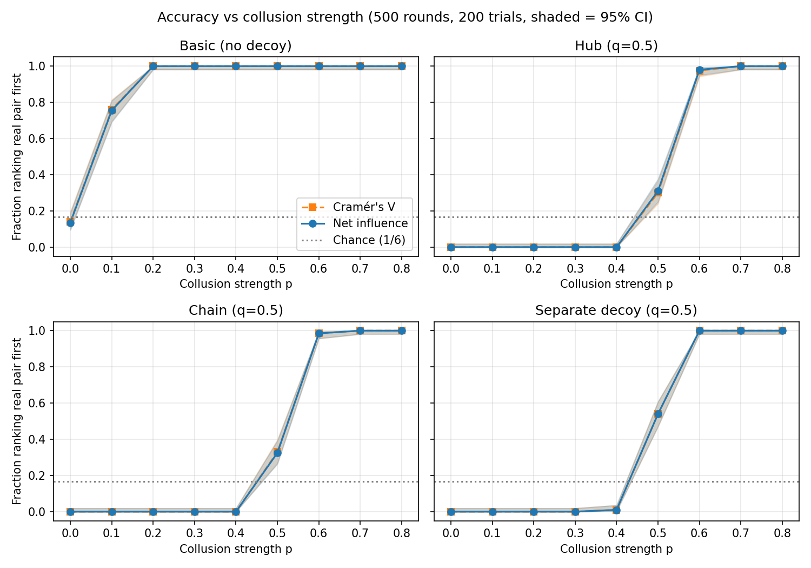
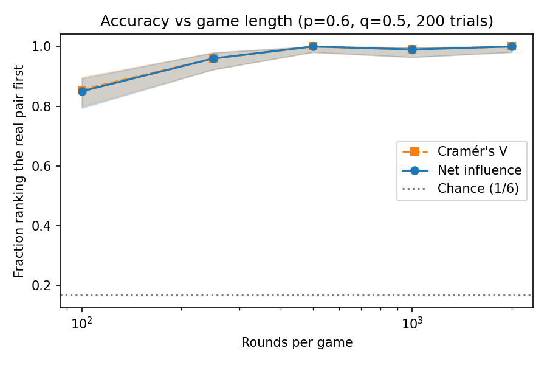

# Detecting Colluding Agents with Pairwise Net Influence

Project for the Apart Research AI Collusion Research Sprint (Question 1.4: information-theoretic detection of collusion in multi-agent games).

**Research question:** Can pairwise net influence (Bonjour et al., 2022) identify a colluding pair among four agents in repeated Rock-Paper-Scissors, and does it beat plain correlation (Cramér's V)?

**Answer in this toy setting:** Both methods found the planted pair equally often. I found no evidence that net influence outperforms plain correlation.

## What I did

- Implemented pairwise net influence for the fully observable simultaneous case of Bonjour et al. (2022). Mutual information between two agents' moves gives γ(i;j). Then Γ(i;j) = γ(i;j) − max over k ≠ i, j of γ(k;j). Each pair is scored as min(Γ(i;j), Γ(j;i)).
- Added a Cramér's V baseline (the paper has no baseline).
- Simulated four-agent Rock-Paper-Scissors with one planted colluding pair, agents 2 and 3. Agent 3 plays the move that beats agent 2's move with probability `p`.
- Tested four scenarios: no decoy, hub decoy, chain decoy, and a separate decoy pair (decoy strength `q = 0.5`).
- A trial succeeds if the top-ranked pair is (2, 3). Chance is 1/6. Each setting uses 200 trials with 95% Wilson confidence intervals.

## Differences from the paper

- Four players instead of three, and a different hand-crafted collusion rule.
- Only the fully observable simultaneous case. No poker, no sequential games, no learned (DDQN) colluders.
- Pairs are ranked by min(Γ(i;j), Γ(j;i)) instead of applying a threshold α, so I never tested the "no collusion" case.
- Cramér's V baseline and the hub/chain/separate decoys are my additions.
- This is an implementation, not a replication of the paper's results.

## Results

### Accuracy vs collusion strength



*Fraction of trials in which each method ranked the real pair first (500 rounds, q = 0.5, 200 trials per point, shaded = 95% Wilson CI, dotted = chance).* With no decoy both methods reach 1.00 by p = 0.2. With a decoy, both stay near 0 until the real pair is about as strong as the decoy, then rise sharply. The two curves overlap in every panel.

### Accuracy vs game length



*Separate decoy, p = 0.6, q = 0.5, 200 trials per point.*

| Rounds | Net influence | Cramér's V | Disagreements (of 200) |
|---|---|---|---|
| 100 | 0.85 | 0.85 | 3 |
| 250 | 0.96 | 0.96 | 0 |
| 500 | 1.00 | 1.00 | 0 |
| 1000 | 0.99 | 0.99 | 0 |
| 2000 | 1.00 | 1.00 | 0 |

### Where the methods disagree

Across four scenarios and nine values of p (7,200 trials), the methods chose different pairs in 49 trials (0.7%): hub 25, chain 15, basic 5, separate 4. A disagreement does not mean one method won.

| Setting | Net influence right only | Cramér's V right only | Both wrong |
|---|---|---|---|
| Hub, q = 0.5 | 3 | 0 | 22 |
| Chain, q = 0.5 | 1 | 2 | 12 |
| Hub, q = 0.3 | 0 | 0 | 4 |
| Hub, q = 0.7 | 0 | 3 | 16 |
| **Total** | **4** | **5** | **54** |

Each row pools p = 0.0 to 0.8 (1,800 trials). The hub q = 0.3 and q = 0.7 rows are extra runs, so the total (63) is larger than the 49 above. Most disagreements are cases where both methods were wrong, and the counts do not favor either method.

Raw numbers are in `results/*.csv`.

## Limitations

- Toy setting: scripted agents, one game, four players, exactly one colluding pair. LLM agents or other games could change the result.
- Collusion is a simple same-round rule and the decoys are my own constructions.
- No false-alarm test: I always picked the top pair and never ran a no-collusion game under the paper's threshold rule.
- 200 trials per point with seeds shared across p, and only 9 disagreements where exactly one method was right. A small real difference could exist.

## Reproduce

```bash
pip install -r requirements.txt
python -m pytest -q          # 6 unit tests
python run_experiments.py    # regenerates figures/ and results/ (takes a few minutes)
```

All randomness uses `np.random.default_rng(seed)` with seeds 0 to 199, so results are reproducible.

## Repository layout

```
collusion/simulators.py   four scenario simulators
collusion/detectors.py    mutual information, net influence, Cramér's V
collusion/evaluation.py   hit rates, Wilson intervals, disagreement classification
run_experiments.py        runs all experiments, writes figures/ and results/
tests/                    pytest unit tests
figures/  results/        outputs
```

## Reference

Bonjour, T., Aggarwal, V., and Bhargava, B. (2022). Information theoretic approach to detect collusion in multi-agent games. Proceedings of the 38th Conference on Uncertainty in Artificial Intelligence, PMLR 180:223-232. https://proceedings.mlr.press/v180/bonjour22a.html


